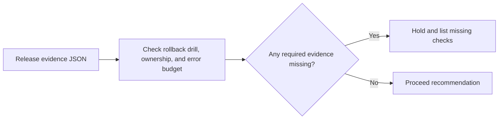

# Production Release Readiness

A deployment needs an accountable owner, rollback drill evidence, and sufficient error budget before an operator can approve it.

## What I built

I built a release checklist that requires a completed rollback drill, a named owner, and enough remaining error budget. It returns a proceed or hold recommendation with failed checks listed.

## How it works



[Architecture](docs/ARCHITECTURE.md) · [Decision rules and source](docs/RULES.md)

## Tools used

| Tool | Role in this repository |
| --- | --- |
| Python | [agent.py](agent.py) implements the CLI and decision rules. Uses `argparse` to parse command-line options, `json` to read or write structured records, `pathlib` to read local files. |
| Make | Runs the documented example and local checks. |
| Python replay runner | Compares actual stdout with the checked-in baseline fixtures. |
| Ruff and Bandit | Developer lint and static security checks through `make check`. |

## Run the project

Use Python 3.10+ and Make. From the repository root:

```sh
python3 agent.py example.json
```

The fixture holds the release because the remaining SLO budget is below its configured minimum. [Full expected output](examples/Bundled%20scenario.stdout.txt)

### Additional replay cases

- **Regression scenario** · `python3 agent.py examples/regression.json` · [Expected output](examples/Regression%20scenario.stdout.txt)

## Verify the project

```sh
make verify
make replay
```

`make replay` checks the recorded cases and exits nonzero if the output changes.
See the [developer guide](docs/DEVELOPMENT.md) for the pinned lint and security tools.

## Operating limits

The CLI checks supplied evidence fields. It does not validate their provenance, approve a release, or deploy it.

[Case study](docs/CASE_STUDY.md) · [Operator runbook](docs/RUNBOOK.md) · [Verification report](reports/verification.md)
