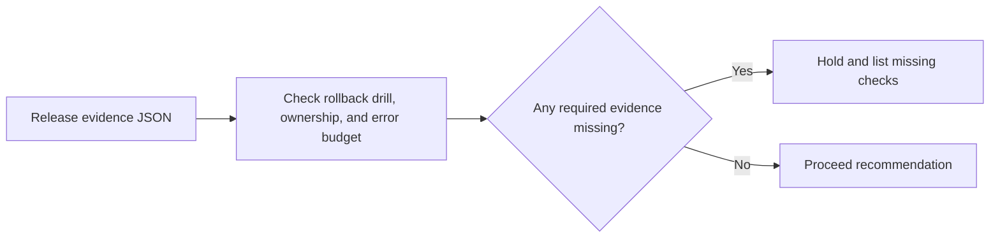

# Production Release Readiness architecture

Evaluate whether a production release has enough operational evidence to proceed.

## Operational boundaries

The documented run evaluates the bundled sample locally. Results depend on the quality and scope of the input. The demo makes no live infrastructure changes.
